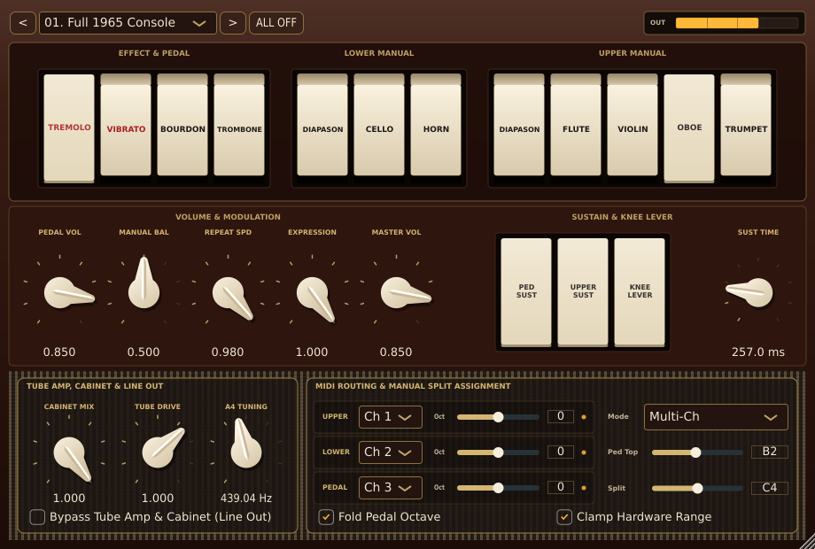

<p align="center">
  
</p>

<h1 align="center">ET-5M Organ</h1>
<p align="center">
  <strong>Retro Home Organ Series #2</strong> by <strong>Yuguen Organ (ゆうげんオルガン)</strong><br>
  1965 Hybrid Electronic Organ Synthesizer &mdash; VST3 / macOS AudioUnit (AU) / Standalone
</p>
<p align="center">
  <em>Current Status: Public Alpha (<code>v0.1.0-alpha</code>) &bull; License: GPLv3</em>
</p>

<p align="center">
  
</p>

---

## Overview / 概要

**ET-5M Organ** is the second instrument in the **Retro Home Organ Series** developed by **Yuguen Organ (ゆうげんオルガン)**.
Built in real-time C++20 DSP (`JUCE 8`), it models the warm tone-generator harmonics, analog formant filter banks, manual keying/sustain response, modulation LFO, and vintage vacuum-tube cabinet acoustics of a 1965 hybrid electronic home organ.

**ET-5M Organ** は、**Yuguen Organ（ゆうげんオルガン）** が贈る **Retro Home Organ Series 第2弾** です。
1965年製の真空管＋半導体ハイブリッド電子オルガンの質感あるトーンジェネレーター倍音・フォルマントフィルタバンク・サスティン／ニーレバー応答・モジュレーション LFO・および真空管パワーアンプ＆スピーカーキャビネット特性を、リアルタイム C++20 DSP（JUCE 8）で再現した VST3 / AU / Standalone インストゥルメントです。

> [!NOTE]
> This is an **Alpha release (`v0.1.0-alpha`)**. Feedback, bug reports, and DAW compatibility reports via GitHub Issues are welcome.

---

## Key Features / 主な機能

- **3-Manual Architecture (44 / 44 / 13 Keys)**
  - **Upper Manual (44 keys, F3–C7)**: 5 stop tablets (`DIAPASON`, `FLUTE`, `VIOLIN`, `OBOE`, `TRUMPET`) + `UPPER SUST`
  - **Lower Manual (44 keys, C2–G5)**: 3 stop tablets (`DIAPASON`, `CELLO`, `HORN`) + `MANUAL BAL`
  - **Pedalboard (13 keys, C2–C3)**: 2 stop tablets (`BOURDON`, `TROMBONE`), authentic strict **monophonic low-note priority** response + `PED SUST` & `PEDAL VOL`
- **Modulation, Sustain & Expressive Controls**:
  - `TREMOLO` and `VIBRATO` controlled by shared `REPEAT SPD` rate dial
  - `PED SUST`, `UPPER SUST`, and `KNEE LEVER` sustainer tablets with adjustable `SUST TIME`
  - `EXPRESSION` pedal, `MASTER VOL`, and fine `A4 TUNING` calibration
  - Bandlimited oscillator rendering and antiderivative anti-aliased (`ADAA1`) tube nonlinearity for clean upper-register response
- **1965 Vacuum Tube Amp, Cabinet & Line Out Flexibility (Mono / Stereo)**:
  - Clean single **Mono / Stereo** output bus (`Output`) with continuous `CABINET MIX` blend and `TUBE DRIVE` control
  - **`Bypass Tube Amp & Cabinet (Line Out)`** toggle for routing the dry organ circuit directly into external amp simulators, spring/plate reverbs, or studio FX chains
- **5 Built-in Registration Presets & Intuitive MIDI Routing**:
  - Multi-Channel mode (`UPPER`, `LOWER`, `PEDAL` independently assignable to `Omni / Ch 1..16 / Off`) and Single-Keyboard `Split` mode (`Ped Top` & `Split`)
  - Per-manual octave shifts (`-2..+2`), compact MIDI activity indicators per manual row, `Fold Pedal Octave`, `Clamp Hardware Range`, `CC#11` Expression, `CC#7` Volume, and `CC#64` Knee/Sustain pedal support

---

## Download & Installation / ダウンロードと導入方法

Pre-built binaries are published on the [GitHub Releases](../../releases) page (`.zip` archives for **Windows x64**, **macOS Universal arm64+x86_64**, and **Linux x64**).

### Windows (x64)
- **VST3**: Copy `ET-5M Organ.vst3` into `C:\Program Files\Common Files\VST3\`
- **Standalone**: Run `ET-5M Organ.exe` directly from any folder
- **Audio Driver Note**: The Standalone app uses **Windows Audio (WASAPI Shared / Exclusive / Low Latency)** and **DirectSound** (it does not bundle proprietary ASIO drivers). If you prefer using an ASIO audio interface directly, please load `ET-5M Organ.vst3` inside an ASIO-compatible DAW or VST3 host.

### macOS (Apple Silicon + Intel Universal)
- **VST3**: Copy `ET-5M Organ.vst3` to `/Library/Audio/Plug-Ins/VST3/`
- **AudioUnit (AU)**: Copy `ET-5M Organ.component` to `/Library/Audio/Plug-Ins/Components/`
- **Standalone**: Copy `ET-5M Organ.app` to `/Applications/`

> [!IMPORTANT]
> **macOS Gatekeeper Notice (Alpha Unsigned Builds)**
> Because alpha builds are not yet Apple-notarized, macOS may show a *"cannot be opened / damaged"* warning on first launch. After copying the files, clear the quarantine attribute in Terminal:
> ```bash
> xattr -cr "/Library/Audio/Plug-Ins/VST3/ET-5M Organ.vst3"
> xattr -cr "/Library/Audio/Plug-Ins/Components/ET-5M Organ.component"
> xattr -cr "/Applications/ET-5M Organ.app"
> ```
> When upgrading an AudioUnit in Logic Pro, run **Settings > Plug-in Manager > Reset & Rescan Selection** if channel configuration caches from older builds persist.

### Linux (x64)
- **VST3**: Copy `ET-5M Organ.vst3` to `~/.vst3/`
- **Standalone**: Make `ET-5M Organ` executable (`chmod +x "ET-5M Organ"`) and run it

---

## Build from Source / ソースからのビルド

Requirements: CMake >= 3.22, a C++20 compiler, Git, and internet access (to fetch JUCE 8.0.6 and Catch2 v3.7.1 via `FetchContent`).

```bash
# Configure & Build (Release VST3 / AU / Standalone / Catch2 Tests)
cmake -B build -DCMAKE_BUILD_TYPE=Release
cmake --build build --parallel

# Run all 16 Catch2 DSP & Plugin unit tests
ctest --test-dir build --output-on-failure -V
```

*(On Linux, pass `-G Ninja` if using Ninja; on macOS Universal builds, add `-DCMAKE_OSX_ARCHITECTURES="arm64;x86_64"`.)*

---

## License & Disclaimer / ライセンス・免責事項

- **License**: Released under the **GNU General Public License v3.0 (GPLv3)** (compatible with JUCE 8 open-source licensing). The copyright holder (**Yuguen Organ**) retains the right to distribute this software under separate commercial or proprietary license terms. By submitting a Pull Request or contribution to this repository, you agree that your contribution may be licensed and distributed under both GPLv3 and separate commercial terms; see [LICENSE](LICENSE) for full details.
- **Framework**: Built with [JUCE 8](https://juce.com/).
- **Disclaimer**: *ET-5M Organ* is an independent software modeling project created by **Yuguen Organ (ゆうげんオルガン)**. It is not affiliated with, endorsed by, or sponsored by any hardware musical instrument manufacturer. All stop names refer to traditional electronic organ registration terminology.
